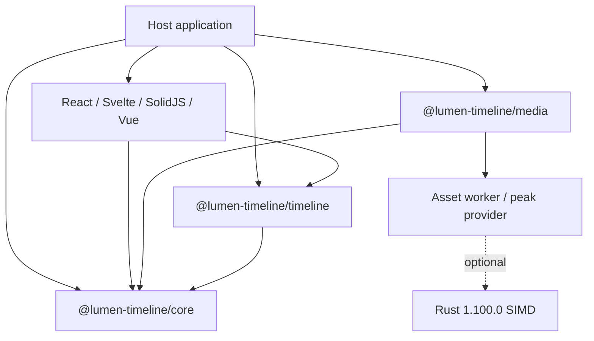

# Core implementation architecture

This is the implementation contract for the first release of Lumen Timeline. One editor owns the project, edit history, selection and transport. The core, media and timeline packages are written in strict TypeScript and compiled by tsrs. [TypeScript core plan](plans/typescript-core.md) It can run in Node, attach to an existing player, or drive several views of the same project. Browser adapters own playback and drawing resources. The optional Rust 1.100.0 WebAssembly component reduces large PCM buffers into waveform peaks.

The [product design](design.md) defines the editing behavior, including trim, split, move and takes. The [roadmap](../ROADMAP.md) defines the release gates. The contracts below apply across all packages. File names and internal data structures can evolve behind them.

## Package and runtime boundaries

Arrows indicate imports. The application injects its player, asset resolver and storage when it constructs the editor. The core can therefore call a media driver without importing a browser package.

| Owner                                  | Responsibilities and lifetime                                                                                                                                                                         |
| -------------------------------------- | ----------------------------------------------------------------------------------------------------------------------------------------------------------------------------------------------------- |
| Core, on the editor's owning JS thread | Time conversion, immutable project revisions, commands, history, track interval indexes, session state, transport state and pure playback planning. One instance per editing session.                 |
| Media, on the browser main thread      | Observe the chosen clock, resolve media, execute a playback plan, create and cancel Web Audio nodes and route the mix. One driver per editor. The host retains ownership of a supplied media element. |
| Media asset worker                     | Build and cache waveform tiles. Accept transferable typed arrays and cancellation. The media package exposes the resulting tiles through a provider the view can consume.                             |
| Timeline, on the browser main thread   | Mount into a supplied element. Compute visible layout and hit regions, then render through WebGL2, opt-in WebGPU or Canvas 2D. Each mount owns its DOM, subscriptions and drawing resources.          |
| Framework wrappers                     | Mount the same timeline after client mount, forward options and bridge field selectors. Each wrapper has its own framework peer.                                                                      |
| Host and domain plugins                | Own files, credentials, persistence, jobs and domain semantics such as script text, speaker and review state. Plugins contribute validated document operations and UI slots.                          |

The dependency test imports the core in Node with no DOM, audio device, GPU, worker or WASM loader. An application can mount a timeline and a minimap over the same editor. Disposing either view releases its resources. Disposing the editor rejects pending transport requests, cancels its work, detaches the driver and ends all editor subscriptions.

### Headless module interfaces

| Module               | Input                                                                 | Output or effect                                                                                                                                |
| -------------------- | --------------------------------------------------------------------- | ----------------------------------------------------------------------------------------------------------------------------------------------- |
| Time                 | Safe integer, rational rate and explicit source or project unit       | Tick, sample index or frame boundary. A range error identifies an invalid rate or unrepresentable result.                                       |
| Document and history | Versioned JSON on load, or a validated command on a document revision | Immutable snapshot, forward/inverse patches and changed IDs. History owns its cursor. A public snapshot is safe to retain across later edits.   |
| Queries and planner  | Snapshot and track/time range                                         | Ordered overlapping clips or audible spans for one revision. Queries share the document's interval index with the view and planner.             |
| Transport            | Playback intent and timestamped player observations                   | State snapshot, monotonically increasing generation, requested/presented ticks and frame subscriptions. An injected driver performs device I/O. |
| Editor               | Project, optional media driver and registered plugins                 | Owns the module instances. Exposes dispatch, history, session, selectors, transport and disposal to the host.                                   |

On a successful `dispatch(command)`, observers receive the committed revision, affected IDs and track intervals in project ticks. Store the inverse patch in history. A rejected dispatch returns a typed reason and leaves the revision untouched. A playback span carries source units and their rate up to the scheduling boundary. A worker receives PCM and tile keys. These contracts let the planner run under a fake clock and the GPU view run from a saved snapshot.

## Document, commands and subscriptions

The project document is the sole durable source of editing data. A clip stores its placement, content offset, candidate take IDs and active take ID. A take refers to an asset, a stream and a source position in project ticks. The host catalog supplies the asset version and available samples. Clips share takes by ID, as both halves of a split do. Session selection and the transport's currently audible clip IDs are independent. Playing through an unselected line must leave the inspector's selection and text focus intact.

| Change                             | Write path                       | Subscribers                                                                              |
| ---------------------------------- | -------------------------------- | ---------------------------------------------------------------------------------------- |
| Edit, undo or redo                 | Synchronous document transaction | Project selectors, affected interval indexes, playback planner and persistence           |
| Select, zoom or preview a drag     | Ephemeral session update         | Selectors for that selection, viewport or preview                                        |
| A frame arrives or playback stalls | Transport observation            | Playhead and time display through the frame channel, state controls on state transitions |

A command follows one commit protocol.

1. Read the current document and resolve stable IDs. Validate bounds, track locks and overlap policy. Run deterministic plugin validation and split rules on the same candidate change.
2. Produce forward and inverse patches, created IDs and the **old and new** track/time intervals. A rejected edit returns its target and reason and publishes no changes.
3. Commit the candidate document and its affected indexes together. Increment the revision once, record the entry when the transaction selects recording, and publish the change. Subscribers see a coherent revision. A drag uses this same validation for preview and commits once on release.
4. Undo applies the recorded inverse in a new revision. Redo reuses the recorded IDs and patches. A recorded edit after undo clears the redo branch. Ignored transactions preserve both stacks. Replay maps stable IDs and checks owned fields against the current document. A restore or migration validates a copy before replacing the live document. [Selective history contract](selective-history.md)

An inspector subscribes to a stable snapshot of the fields it displays, such as selected clip ID and active take ID. Unchanged selections reuse snapshot identity. A transport frame has no document revision and never causes a history entry. Plugin network work runs outside this transaction. A returned take carries the target clip ID, line revision and content offset. Validate them again before adding the result. Preserve unknown plugin payloads on save and disable a split when the missing plugin owns its split semantics.

Persist an immutable project snapshot with the storage adapter's last acknowledged revision. Edits made during a save remain pending for the next write. A compare-and-swap conflict returns to the host for reconciliation. Keep the storage version separate from the local undo cursor and transport generation.

## Time and the playback plan

Use integer project ticks at 282,240,000 Hz and half-open intervals throughout the model. Source PTS, rational frame rates and audio sample indices retain their native units. Use exact integer fast paths for common rates and a BigInt intermediate when products exceed the safe-integer range. Round absolute source boundaries to the nearest native unit, with ties away from zero. Both halves of a split use the same converted edge. Browser seconds enter only at adapter boundaries.

The core exposes a pure planner. Given one project revision, track mix and a requested interval, it returns audible spans. Each span identifies its clip, active take, asset version, stream, project interval, source interval and gain route. Intersect the query with both the clip and its take's available source range. Realtime playback queries a short future interval and includes clips already in progress. An exporter can query the full revision with the same mapping.

For example, a clip at **12 s**, with **1 s** of content offset and a take whose source origin is zero, maps a seek to **14.2 s** to source **3.2 s**. Splitting at 14 s produces a right clip with content offset 3 s. Switching that half to a fresh recording with source origin −3 s makes the same seek play source 0.2 s. Undoing that take change restores the original take and its 3.2 s offset. Other tracks continue playing throughout.

The planner and driver use three identifiers to decide whether a result still applies.

| Identifier                   | Changes on                                                                                       | What it invalidates                                                                                                                                                 |
| ---------------------------- | ------------------------------------------------------------------------------------------------ | ------------------------------------------------------------------------------------------------------------------------------------------------------------------- |
| Document revision            | Each accepted edit, undo, redo or document replacement                                           | Selectors and affected render or playback spans. A clip move invalidates its old and new intervals. An unrelated text edit can preserve the current audio schedule. |
| Transport generation         | A discontinuity such as seek, loop wrap, stall recovery, clock replacement or output-rate change | Frame callbacks, pending starts and shared output boundaries derived from the old clock anchor.                                                                     |
| Asset ID and content version | Source replacement                                                                               | PCM and peak tiles for the replaced source. An old worker reply can never populate the cache for the new version.                                                   |

Each scheduled voice also has an identity in the current plan. On a local edit, cancel old work for changed voices and compare that identity before attaching an asynchronously resolved buffer. A global revision check alone would unnecessarily interrupt unaffected tracks.

## Transport and audio scheduling

Only one device determines project time at a time. In reference-video mode it is the video. In an audio-only project it is the audio output clock. An external player provides position, observation time, speed, state and capabilities through the adapter. A coarse external clock supports a playhead and markers. Enable synchronized mixing for that adapter after its output has passed the sync tests.

The transport keeps playback intent, requested tick and observed presentation tick separately. A scrub can move the requested cursor immediately. An observed frame confirms what the preview has reached. The driver consumes device observations directly. A mounted view can subscribe to frame notifications or unsubscribe while audio scheduling continues.

| Event                         | Transition and effect                                                                                                                                                                                                                                                                                      |
| ----------------------------- | ---------------------------------------------------------------------------------------------------------------------------------------------------------------------------------------------------------------------------------------------------------------------------------------------------------- |
| Play or pause                 | Enter starting until the device is ready. On refusal, expose the reason. On pause, freeze observed position and stop reserved voices.                                                                                                                                                                      |
| Seek                          | Invalidate the old schedule. Keep one native seek in flight and the newest waiting target. Coalesced callers receive a superseded result. A native completion has no request ID. Check the element's seeking state and reached position before accepting it. Timeouts and disposal settle waiting callers. |
| Waiting or interrupted output | Freeze the cursor and silence scheduled audio. On recovery, observe the reference again and schedule from the source offset at the recovered position.                                                                                                                                                     |
| Rate change or loop boundary  | Acquire a fresh clock anchor and schedule the new generation. At the end of a range stop, or seek to the loop start.                                                                                                                                                                                       |
| Local edit while playing      | Replan affected voices, including any voice spanning the playhead. Reapply from its mapped source offset. Unaffected voices retain their nodes.                                                                                                                                                            |

For reference video, pair the frame PTS with its expected display time. Convert display time to the audio clock with the output timestamp's performance-time/context-time pair. Compare time origins before subtraction. If the frame timestamp is unusable, fall back to callback arrival and report estimated precision. If the adapter lacks usable observations, expose its degraded capability. Output diagnostics include clock source, precision, generation, dropped observations and scheduled range.

Start with the tested 25 ms scheduler wakeup and 100 ms lookahead. The timer supplies future work. Web Audio executes it on the output sample grid. Apply these rules to adjoining audible spans on a continuous route.

1. Project a start and end onto **absolute integer output samples**. Record the end sample for that project edge and generation. The next contiguous span must reuse it as its start.
2. Project the new span's far edge from the latest clock observation. Keep the shared start fixed and bound the change in the new span's length to 0.1% of its nominal duration. When a correction is needed, adjust the source consumption rate to cover exactly its source range.
3. Start with the correct source offset and explicitly stop at the absolute end sample. Clear obsolete boundaries on discontinuities or when their adjoining schedule is replaced. Independently mixed voices keep their own continuity chains.
4. For long decoded stems, supply bounded contiguous source windows through the asset provider so the scheduler has correction opportunities. Ten-second windows have been measured. Continuous-stem playback at other window sizes, seams at non-unit speeds and physical output latency are release tests.

A relative duration can double one boundary sample. Choosing two independent clock projections for one seam can produce an extra pulse. Reusing the first projection for every future edge can accumulate drift. The shared start and freshly projected far edge address these distinct faults.

## Waveforms, rendering and extension points

A peak request identifies asset ID, content version, stream/channel, samples per bucket and tile index. The worker reduces the actual finite samples in each bucket to min/max pairs, including the final partial bucket. Empty buckets carry no samples. Clip placement, trim and viewport state are outside this cache key. The view can display a clip and its handles while its waveform is loading.

Use a JS reduction for small requests. Batch large uncached ranges, then use the optional Rust **1.100.0** SIMD kernel inside the worker. Give the kernel a bounded contiguous Float32 input and a caller-sized output buffer. Validate lengths before passing offsets into WASM memory and refresh typed-array views after memory growth. Transfer worker-owned scratch buffers or owned copies. Keep live playback buffers available to the mixer. If SIMD, module loading or allocation fails, run the same request through JS. If workers are unavailable, divide JS work into cancellable slices. Publish the effective compute backend separately from the drawing backend.

The JS/WASM cutoff is a tunable worker policy. The measurements below establish two useful sizes. They do not establish a portable crossover. Both backends must return identical min/max values for the same input, including partial buckets. Bound PCM, tile and GPU caches separately. Prefer data needed near playback and the visible viewport, then evict inactive entries.

The timeline reads visible placements through the core's per-track interval index. Query every interval satisfying `start < viewEnd && end > viewStart`, including a long clip that begins offscreen. One CPU layout supplies rectangles, hit regions and stacking order to WebGL2, WebGPU and Canvas 2D. Subtract the viewport origin before uploading floats. Rebuild the view from CPU state after device loss. With fixed viewport and content, playback updates the playhead and active highlights without uploading static clip buffers.

React, Svelte, SolidJS and Vue each mount this same view and expose the same command path to host panels. A keyboard trim, a pointer trim and an inspector trim submit the same command. A framework consumer may subscribe to selected fields and compose a dubbing or podcast workspace without owning the project store, audio graph or draw loop.

## Evidence and implementation gates

The measurements below were taken on an Apple M1, macOS 26.5.2. The clock probe compared a pixel-coded flash with a pulse detected in the browser's audio graph. WebKit used callback arrival when its frame display timestamp had a different time origin. The browser probe measures up to the output graph and estimated frame presentation. The wired display/speaker gate remains open. [Recorded measurements](measurements/clock-and-wasm.json)

| Observation                                                                                                                                                                                                                                             | Architectural consequence                                                                                                                                                                              |
| ------------------------------------------------------------------------------------------------------------------------------------------------------------------------------------------------------------------------------------------------------- | ------------------------------------------------------------------------------------------------------------------------------------------------------------------------------------------------------ |
| Chrome, 30 minutes at 30 fps and 48 kHz. Independent seam projections gave 1,791/1,800 pairs and 135 unpaired pulses despite a paired p95 of 5.63 ms. The corrected run gave 1,800/1,800 pairs, zero unpaired pulses, p95 6.29 ms and maximum 33.46 ms. | Gate on signal integrity and p95. The maximum slightly exceeded one 33.33 ms frame. Preserve counts of missing and duplicate observations.                                                             |
| At 44.1 and 48 kHz the four offline split fixtures in each of three browsers had zero sample error. Injecting 100 ms downstream delay in Chrome produced a p95 of 105.38 ms.                                                                            | Keep an exact-sample test and an independent negative control alongside realtime tests.                                                                                                                |
| With 1,048,576 samples, full worker round-trip medians for JS / Rust SIMD were 1.41 / 0.59 ms in Chrome, 1.63 / 0.50 ms in WebKit and 2.00 / 0.38 ms in Firefox. For 4,096 samples the medians differed by less than 0.004 ms.                          | Load WASM for large waveform batches. Keep scalar clip queries in JS. Rust also accelerated batches of late microsecond PTS, which can be reconsidered if a representative import profile warrants it. |

Implement in dependency order. Each step has an observable exit condition.

1. **Headless core.** Golden fixtures must cover fractional-frame and sample conversions, source mapping, atomic trim/split/move, independent take choice, revision conflicts and undo/redo with stable IDs. A missing plugin must survive a save/load round trip.
2. **Clock and media driver.** Use fake clocks for cancellation and ±100 ppm skew, offline samples for seam identity, and real browser probes for stalls, seeks, take replacement and long playback. Validate audio-only mode, long stems and wired physical output before claiming the release-level A/V budget.
3. **Vanilla view and waveform worker.** Compare hit geometry and edits on all three drawing backends. Force device loss, stale worker replies and JS/WASM fallback. Validate small, large and partial tiles and zero static geometry uploads during steady playback.
4. **Wrappers and domain applications.** Run the same selection, seek and edit trace through vanilla and the four latest-stable-major wrappers. Compare project snapshots and frame-time distributions. A selected-take inspector receives zero changes during steady playback with a fixed selection and take. Build the dubbing and podcast examples through public exports. [Wrapper release criteria](../ROADMAP.md#wrapper-acceptance-tests)
